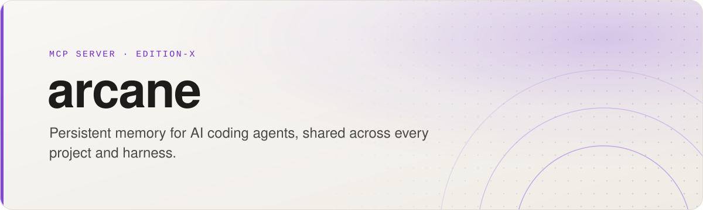

<picture>
  <source media="(prefers-color-scheme: dark)" srcset=".github/assets/banner-dark.svg">
  
</picture>

<p align="center">
  <a href="https://github.com/Edition-X/arcane/actions/workflows/ci.yml"></a>
  <a href="https://pypi.org/project/arcane-mcp/"></a>
  <a href="https://pypi.org/project/arcane-mcp/"></a>
  <a href="https://scorecard.dev/viewer/?uri=github.com/Edition-X/arcane"></a>
  <a href="LICENSE"></a>
</p>

<p align="center">
  <a href="#quick-start">Quick start</a> ·
  <a href="#connect-an-agent">Connect an agent</a> ·
  <a href="#use-it-from-the-terminal">CLI</a> ·
  <a href="#configuration">Configuration</a> ·
  <a href="docs/README.md">Docs</a>
</p>

Arcane is an [MCP](https://modelcontextprotocol.io) server that gives coding agents such as Claude Code and Codex a memory that outlives the session. Agents save the decisions, bugs and patterns they work through. The next session, in any harness, finds them again with keyword and semantic search.

Everything stays on your machine: one SQLite database plus a Markdown copy you can read and grep. Secrets are redacted before anything is written or sent to the embedding model.

```bash
arcane search "why were customers charged twice"
```

```console
 Results (4 found)

 [1] Webhook retries double-charged customers (score: 1.00)
     bug | 2026-10-24 | payments-api
     What: Stripe retried webhooks after our 10s timeout and each retry created a new charge.
     Why: Handler was not idempotent; it keyed on our own request ID, not Stripe's event ID.
     Impact: Dedupe on event.id in a unique index; refunds issued to 14 customers.

 [2] Use Postgres advisory locks for payout batches (score: 0.83)
     decision | 2026-10-24 | payments-api
     What: Payout batches take a pg_advisory_xact_lock keyed on merchant ID.
```

> **Pre-1.0.** The MCP tool surface and the storage format can still change between minor versions. Run `arcane backup` before upgrading, and read the [release notes](https://github.com/Edition-X/arcane/releases).

## Quick start

Arcane needs Python 3.11 or later. For semantic search, install [Ollama](https://ollama.com) and pull the default embedding model. Without it, search falls back to keyword matching.

```bash
uv tool install arcane-mcp        # or: pip install arcane-mcp
ollama pull nomic-embed-text
arcane init                       # creates ~/.arcane
```

The package is `arcane-mcp`. PyPI's `arcane` is an unrelated project.

Arcane starts a local Ollama by itself when it is installed but not running. Set `ARCANE_OLLAMA_AUTOSTART=0` to stop that.

## Connect an agent

Arcane speaks MCP over stdio, so any MCP client can run it with `arcane mcp`.

| Client | Command or config |
|---|---|
| Claude Code | `claude mcp add --scope user arcane -- arcane mcp` |
| Codex | `codex mcp add arcane -- arcane mcp` |
| Claude Desktop | the JSON below, in `~/Library/Application Support/Claude/claude_desktop_config.json` |

```json
{
  "mcpServers": {
    "arcane": { "command": "arcane", "args": ["mcp"] }
  }
}
```

If a client cannot find `arcane`, use the full path that `command -v arcane` prints.

<details>
<summary>Run it in a container</summary>

Each release also ships a container image, plus wheel and source assets with build provenance on its [GitHub release](https://github.com/Edition-X/arcane/releases). The image runs `arcane mcp` and keeps its data in `/data/.arcane`:

```bash
docker run -i --rm -v "$HOME/.arcane:/data/.arcane" ghcr.io/edition-x/arcane
```

The container cannot see your working directory's git remote, so memories land in the default org unless the agent passes `org` and `project` explicitly.

</details>

## What agents get

By default the server advertises 13 tools, the ones an agent uses in every session. Set `ARCANE_TOOL_PROFILE=full` for all 26, including deletion, ingestion, analysis and content drafting. Every tool and its parameters are in the [tool reference](docs/mcp-tools.md).

| Area | Default tools |
|---|---|
| Memories | `memory_save`, `memory_search`, `memory_context`, `memory_details`, `memory_update` |
| Journeys | `journey_start`, `journey_update`, `journey_complete`, `journey_abandon`, `journey_list`, `journey_show` |
| Lookups | `artifact_search`, `insights` |

- **Memories** are one decision, bug, pattern, learning, piece of context, spike result or milestone each. Saving a title that already exists in the same scope updates that memory, and `memory_save` warns when a new memory is close to an existing one, so the store does not fill with duplicates. A memory can also `supersedes` an older one, which search then ranks lower.
- **Journeys** follow a multi-step investigation from problem to outcome, with memories attached as it goes.
- **Artifacts** are git commits, GitHub Actions runs and Linear tickets you ingest, so a memory can point at the evidence.

## Use it from the terminal

The CLI reads and writes the same store as the MCP server. `arcane <command> --help` shows every option.

| Task | Command |
|---|---|
| Save a memory | `arcane save --title "..." --what "..." --category decision` |
| Search | `arcane search "query"` |
| Print context for an agent prompt | `arcane context` |
| Read or delete one memory | `arcane details <id>`, `arcane delete <id>` |
| Track an investigation | `arcane journey start --title "..."`, then `update`, `complete`, `list`, `show` |
| Ingest evidence | `arcane ingest git`, `arcane ingest gha --owner <owner> --repo <repo>`, `arcane ingest linear --team <key>` |
| Analyse the store | `arcane analyze velocity`, `arcane analyze health`, `arcane analyze usage` |
| Report on a period | `arcane report --days 7`, or `--since`/`--until`, `--org`, `--format json` |
| Draft content | `arcane draft blog`, `arcane draft adr <memory-id>` |
| Link and trace | `arcane link <source> <target> --relation led_to`, `arcane trace <id>` |
| Export one org | `arcane export --org <org>` |
| Back up | `arcane backup` |
| Find and merge split projects | `arcane projects`, `arcane merge-projects <src> <dest>` |

`arcane ingest gha` reads `GITHUB_TOKEN` and `arcane ingest linear` reads `LINEAR_API_KEY`.

## How it works

Every memory belongs to one of three layers:

- **Project:** the repository the agent is working in.
- **Org:** shared by every repository with the same owner.
- **Global:** applies everywhere.

Arcane works out the org and project from the git remote of the agent's working directory, so a session in `acme/payments-api` sees that project's memories, `acme`'s org memories and your global ones. Repositories without a remote fall back to the org `personal`. Agents choose the layer with `memory_save`'s `scope` argument; `arcane save` always writes to the current project. Journeys, artifacts and insights carry their org too, and `arcane export --org` includes only that org's records.

Search combines SQLite FTS5 keyword matching with [sqlite-vec](https://github.com/asg017/sqlite-vec) vector search. Each save is written to SQLite and mirrored to a daily Markdown file:

```text
~/.arcane/
├── index.db                                 # SQLite: memories, journeys, artifacts, links
├── backups/                                 # archives from `arcane backup`
└── vault/
    ├── @<org>/<project>/YYYY-MM-DD-session.md   # project memories
    ├── @<org>/YYYY-MM-DD-session.md             # org memories
    └── @global/YYYY-MM-DD-session.md            # global memories
```

Before anything is stored or embedded, text passes through four redaction layers:

- explicit `<redacted>…</redacted>` spans
- well-known token formats (GitHub, AWS, Stripe, Slack, JWT and others)
- `password=`, `secret=` and `api_key=` style values
- your own regular expressions in `~/.arcane/.memoryignore`

[Architecture](docs/architecture.md) goes deeper.

## Configuration

Arcane reads `~/.arcane/config.yaml`, or `$ARCANE_HOME/config.yaml`. Every setting is optional.

| Setting | Default | What it changes |
|---|---|---|
| `embedding.provider` | `ollama` | `ollama`, `openai` (needs `embedding.api_key` in the file) or `none` for keyword search only |
| `embedding.model` | `nomic-embed-text` | Embedding model. Run `arcane reindex` after changing it |
| `embedding.base_url` | `http://localhost:11434` | Ollama address |
| `context.semantic` | `auto` | Whether `memory_context` uses semantic search: `auto`, `always` or `never` |
| `orgs.remotes` | none | Map a git remote owner to an org name, such as `Sunrise-Robotics: sunrise-robotics` |
| `orgs.default` | `personal` | Org for repositories without a git remote |
| `projects.aliases` | none | Treat two project names as one |
| `dedup.threshold` | `0.92` | Similarity at which a save warns `near_duplicate` |
| `usage.retention_days` | `180` | How long lookup history is kept for `arcane analyze usage` |

The [configuration guide](docs/configuration.md) covers every setting and environment variable.

## Plugins

Ingestion, analysis and content plugins are Python entry points. Install a plugin package into Arcane's environment and its commands appear under `arcane ingest`, `arcane analyze` or `arcane draft`. With `ARCANE_TOOL_PROFILE=full`, agents can also run them through the `plugins` MCP tool. `arcane ingest --list` shows what is installed.

```toml
[project.entry-points."arcane.plugins.ingestion"]
jira = "my_package:JiraIngestionPlugin"
```

The [plugin guide](docs/architecture.md#plugin-system) lists the three protocols and the parameters Arcane passes in.

## Backups and restores

`arcane backup` copies the database with SQLite's online backup API, so it is safe while agents are writing. It checks the copy's integrity, archives it with `vault/`, and keeps the newest 14 archives. `--dest` writes them to another disk.

To restore, stop your agents and unpack an archive into `~/.arcane` or another `ARCANE_HOME`. File paths are stored relative to the home, so a restored copy never edits the original.

## Limits

- **One machine.** The store is local. There is no sync between machines. Move data with `arcane backup` or `arcane export`.
- **Semantic search needs embeddings.** Without Ollama or an OpenAI key, memories save without vectors and search uses keywords only. Some Python builds, such as the python.org installer for macOS, cannot load SQLite extensions and also fall back to keywords. Arcane says so when it starts; on Linux x86_64, `pip install "arcane-mcp[pysqlite3]"` fixes it.
- **Lookups are logged.** By default each MCP lookup is recorded, with its redacted search text, so `arcane analyze usage` can show what agents recall. Set `usage.log_queries: false` to drop the text, or `usage.enabled: false` to record nothing.
- **Redaction matches patterns.** It catches known token formats and the patterns you add, not every secret. Wrap anything sensitive in `<redacted>` tags, or keep it out of memories.
- **Pre-1.0.** Storage and tools can change between minor versions.

## Contributing

Bug reports and pull requests are welcome. [CONTRIBUTING.md](CONTRIBUTING.md) covers the development setup and tests, and [AGENTS.md](AGENTS.md) covers the architecture.

## Licence

[MIT](LICENSE)
